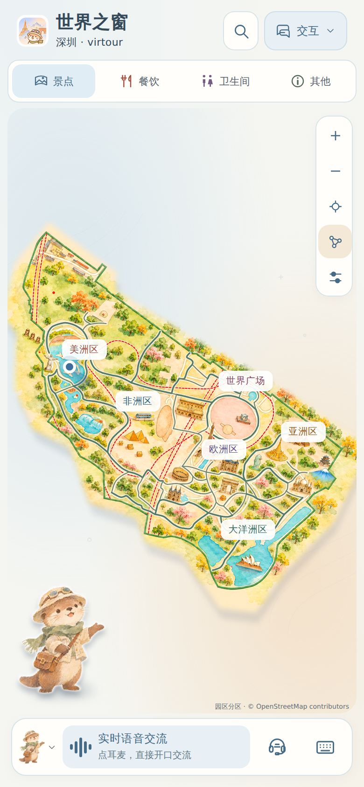
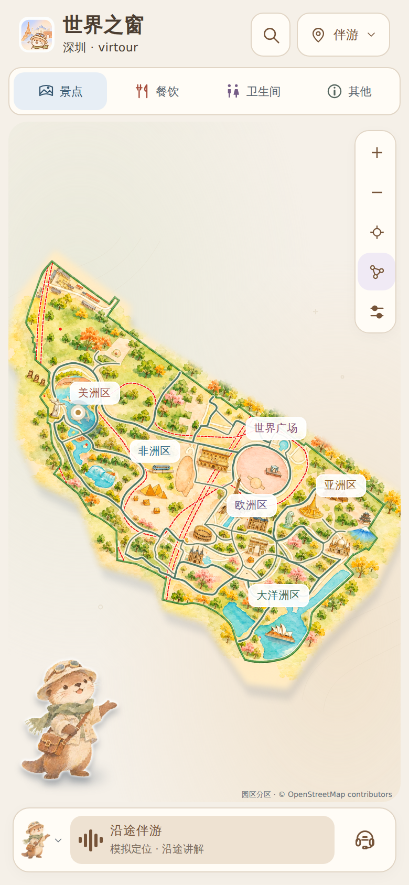

<p align="center">
  
</p>

# VirTour · 把导游装进口袋

**一张手绘地图，两位数字导游。从“这是什么建筑？”聊到“下一站去哪儿？”**

VirTour 是以**深圳世界之窗**为示范场景的数字导览与伴游原型。你可以找景点、问故事、安排游览顺序，也可以走进铁塔实景全景，让讲解带着镜头一起看。

目前以适配手机、平板和桌面的 **Web 应用**交付。它不是官方导览，不是已商业运营的旅游平台，也不是把几张照片包装成“全园 VR”。

[先看功能](#先看能玩什么) · [本地启动](#本地启动) · [逛一圈试试](#五分钟逛一圈) · [技术实现](#背后怎么运转) · [使用边界](#这些事先说清楚)

## 先看，能玩什么？

<table>
  <tr>
    <th>找一处风景</th>
    <th>带上数字导游</th>
    <th>抬头看看铁塔</th>
  </tr>
  <tr>
    <td></td>
    <td></td>
    <td></td>
  </tr>
</table>

以上为当前界面的实际截图。它们展示产品形态，不单独证明语音、后台运行或实地导航效果。

### 💬 好奇就问：交互模式

- **地图不是背景板。** 支持拖动、缩放、全园查看；景点、餐饮、卫生间、其他四类入口，配合名称、别名与区域搜索。缩小后仍保留原手绘图，不切成另一张地图。
- **问故事，也问下一站。** 文字问答可关联景点照片、来源资料与路线。默认约 40% 画面／60% 聊天，支持拖动调整；点击输入时展开编辑，发送后恢复分屏。
- **开口交流，需要你点头。** 点击耳麦才请求麦克风。实时语音集成持续采音、播放、插话打断、静音和结束；能否使用取决于设备权限、网络与供应商模型配置。
- **不只是“讲到铁塔”。** 铁塔有真实六面全景与四个固定看点。固定讲稿按实际音频句首驱动字幕与镜头，手动拖动可打断；文字进入全景不会擅自出声。
- **聊过的，不必从头问。** 历史列表可一击恢复，也能新建会话。记录主要保存在当前浏览器，不是跨设备云同步。

### 🚶 边走边听：伴游模式

选“沐沐”或“绒绒”，查看沿途讲解、位置轨迹与途经亮点。伴游本身**不提供文字输入**；查看历史时会切回交互模式。

默认使用界面明确标注的**模拟定位**。在“定位与演示”里选起点、速度与自动行进，再点击耳麦开始伴游；模拟移动不是游客真实到访。设备定位需要授权，实地到点效果仍需验证。

## 内容不靠“看起来很多”

截至 **2026-11-19**，代码中的实际覆盖为：

- **106 条**景点与体验目录记录，其中 **44 处**有已核对的来源坐标。
- **110 条**结构化知识，覆盖 **18 个**重点景点及园区历史、故事、交通、服务等主题；资料口径截至 **2026-11-12**。
- **1 组**铁塔真实六面全景、**4 个**固定看点；其他地点展示已有实拍或资料。
- **14 个**后端白名单工具，供文字与语音链路共用。工具已注册不代表每项业务都有数据，例如未核实票价时不能计算预算。

目录包含历史记录，**不等于官方全量在营名录**；来源坐标不等于实测入口。知识来自已导入文档，附录来源未逐条独立核验，不能据此承诺当天票价、演出或开放安排。

## 本地启动

需要 **Node.js 24+** 和 npm。首次克隆后：

```bash
git clone https://github.com/FrancesscaWY/world-windown-virtour.git
cd world-windown-virtour
npm ci
npm run dev
```

打开 **http://127.0.0.1:5174/**，从欢迎页进入模式选择。

**先不配密钥也能看界面。** 地图、搜索、本地照片与全景素材可以浏览；真实问答、语音和联网搜索需要相应服务配置。缺密钥或服务调用失败会明确报错，**不会用测试回答冒充 AI**。

### 让导游真正开口

仅在还没有 `.env` 时，复制配置模板；已有配置不要覆盖：

```bash
cp .env.example .env
```

在本机编辑 `.env`，按需填写：

| 想启用什么 | 需要配置什么 |
| --- | --- |
| 文字问答与会话标题 | `CHAT_BASE_URL`、`CHAT_MODEL`、`CHAT_API_KEY`；端点须支持 OpenAI-compatible Chat Completions |
| 实时交流／录音提问 | `DASHSCOPE_API_KEY`；核对 `QWEN_REALTIME_URL`、`QWEN_AUDIO_MODEL`、`QWEN_VOICE` |
| 固定语音讲解与全景带看 | 复用 `DASHSCOPE_API_KEY`；可独立配置 `QWEN_TTS_URL`、`QWEN_TTS_MODEL`、`QWEN_TTS_VOICE` |
| 可选联网检索 | `TAVILY_API_KEY`；未配置时不会声称已联网 |

完整变量与示例见 [`.env.example`](.env.example)。模板中的模型只是配置起点，不保证你的账号已开通；实时模型、地域、音色与额度须匹配。修改后重启服务。

密钥只交给服务端，**不要提交到 Git、写进前端或截图分享**。`.env` 已被忽略，建议限制文件读取权限。

### 手机怎么试？

```bash
npm run dev:lan
```

手机与电脑连接同一网络，打开终端打印的局域网地址。普通 HTTP 局域网地址可测试地图、文字等功能；手机麦克风通常需要**设备信任的 HTTPS**。可通过 `TLS_CERT_PATH`／`TLS_KEY_PATH` 配置证书，或使用正确配置的 HTTPS 反向代理。

`dev`／`start` 默认只监听本机，`dev:lan` 才显式开放局域网。手机访问电脑时不能使用手机自己的 `localhost`。

## 五分钟，逛一圈

1. **先找座塔。** 欢迎页 → 模式选择 → 交互模式。搜索“比萨”，再试试地图缩放与四类入口。
2. **随口问一句。** 切到文字：“世界之窗最著名的景点是哪个？”看看回答、图片与来源如何跟着问题出现。
3. **换个观察角度。** 问“介绍一下埃菲尔铁塔”，进入全景；点击“播放逐句讲解”，观察看点与镜头，再拖动画面打断带看。
4. **让下一站有迹可循。** 问“从当前位置出发，经过埃菲尔铁塔，再到比萨斜塔，帮我规划路线。”地图展示的是沿手绘路网生成的游览示意，**不是实测导航**。
5. **把旅程接上。** 拖动聊天分隔条，新建对话，再从历史列表恢复刚才的问答。
6. **换成边走边听。** 切到伴游，打开“定位与演示”查看模拟起点与速度，点击耳麦开始。定位轨迹和真实语音连接是两件事，别把模拟行程当作现场测试。

也可以试试“世界之窗都逛完大概要多久？”“最近的地铁站在哪里？”。涉及今天的安排时，答案应保留不确定性，而不是编一个笃定的数字。

## 背后怎么运转？

- **前端：** 原生 JavaScript ESM、CSS、Canvas 2D、WebGL。
- **后端：** Node.js 24+、Fastify 5、TypeScript、WebSocket、Zod。
- **外部能力：** 文字大模型、Qwen 语音／TTS，以及可选 Tavily 搜索。

```text
游客输入 + 当前页面上下文
          ↓
模型理解 → 关键词知识检索 / 白名单工具
          ↓
服务端校验 → 有来源的回复与场景指令
          ↓
文字、图片、手绘路线、全景
          ↓
实际音频播放时钟 → 逐句字幕与镜头
```

几个有意做出的取舍：

- **知识先落到资料。** 使用实体、别名与主题关键词检索，保留章节、日期和来源；没有向量数据库、embedding 或基础模型自主训练。
- **模型不随手画路。** 模型选择景点与顺序，后端用共享节点上的 Dijkstra 生成手绘路径，前端校验几何与数据指纹。像素长度只用于图上寻路，不换算成真实步行距离或耗时。
- **地理坐标和画面位置分开。** 经纬度用于附近估算与到点判断，分片仿射配准用于手绘图展示；视觉贴合不是测绘精度保证。
- **声音到了，镜头才走。** 全景固定稿依据 PCM 实际播放时钟切换句子和看点，不按字幕网络到达时间抢跑；也不宣称任意自由回答都能自动镜头同步。
- **数字导游不冒充 3D 真人。** 当前两个角色使用本地 Canvas 2D 分层动画／图集，嘴部随播放状态变化，不是音素级口型同步。
- **旧任务及时收手。** 请求取消、话轮隔离与迟到事件校验用于减少串图、串话和旧镜头覆盖新操作。

### 代码从哪里看？

```text
src/arrival/       欢迎页、模式选择与页面衔接
src/components/    地图、全景、角色、聊天与分屏交互
src/guide/         对话状态、语音话轮、伴游与本地历史
src/data/          景点、设施、手绘路网、配准与热点
src/services/      浏览器采音、播放和后端通信
server/           单端口入口、API、模型、工具与诊断日志
public/           页面、样式、地图、照片及角色素材
native/ios/       待构建与真机验收的 iOS 原生基础
scripts/          资源处理、构建与浏览器验证
tests/            自动化测试
docs/             方案、资料边界与阶段验证记录
```

`server/index.ts` 一次启动页面入口与内部 API，浏览器只访问默认 **5174** 一个端口；内部 API 自动监听本机回环随机端口，无需再开一个终端。

主要接口：`POST /api/guide`（文字）、`POST /api/voice`（录音）、`POST /api/tts`（固定讲稿）、`WS /api/voice/realtime`（实时交流）、`POST /api/conversations/title`（标题），以及健康、配置状态和工具目录接口。

## 这些事，先说清楚

- **能连通，不等于处处验收。** 2026-11-18 的真实服务记录已跑通文字问答、联网资料卡、固定 TTS，以及合成中文提问驱动的实时识别、铁塔带看和路线工具。后者不是游客现场录音，不能替代实体手机、噪声、连续插话和锁屏测试。`/api/status` 的 ready／connected 等配置字段也不是供应商实时可用性探测。
- **路线是示意，信息有日期。** 不承诺真实最短路、精确耗时、入口通行或无障碍路线；不把历史资料当成今天的票价、排队、人流和演出安排。只有铁塔具备当前实景全景，原片局部缺损待补。
- **位置不是默默离线处理。** 默认是模拟位置；设备定位须授权。当前位置及来源会随相关页面上下文发送至后端，并可能进入模型请求和诊断日志。
- **历史不是账户云盘。** 对话历史主要在当前浏览器 localStorage；清理浏览器数据会移除记录，不提供账户间隔离与跨设备同步。
- **日志真的会落盘。** 默认 `logs/chats/` 保存文字诊断，`logs/calls/` 保存通话事件与音频，可能包含私人对话、位置上下文或声音。应限制访问，并制定保留与清理规则。
- **公网部署前，先守住入口。** 当前面向可信单用户演示，缺少完整用户鉴权、多租户与公网限流；HTTP／WebSocket 未做跨站来源限制，已有并发上限不等于防滥用。不要直接无保护地暴露付费模型接口。
- **网页锁屏没有魔法。** 切后台或锁屏可能暂停采音、播放与定位。iOS 目前只有原生壳、后台音频和定位桥接基础，尚未完成 Xcode 构建、签名与真机验收；没有 Android 原生客户端。
- **静态部署只负责画面。** GitHub Pages、纯静态托管和 `file://` 预览不能运行这些后端模型接口。完整体验需要 Node.js 服务和可用的供应商配置。

## 开发与验证

```bash
npm run check     # TypeScript 类型检查 + 模块语法检查
npm test          # 自动化测试
npm run build     # 构建欢迎页、模式页、导览页与离线预览
npm run preview   # 通过同一服务入口预览 dist/，仍可提供后端 API
```

最近一次全量记录为 **528 项测试通过**，检查与构建通过。自动化模型测试使用替身／回环服务，不会因此证明真实供应商或实地游览能力已全部验收。

浏览器专项脚本需要另外准备 Playwright 与 Chromium；部分脚本含环境相关路径，不能假定刚克隆就能直接运行。无需修改代码即可浏览的截图已放在本 README；完整截图包、下载文件与临时验收产物默认不入 Git。

## 想再往里看看？

- [产品与技术文档](docs/PRODUCT_TECHNOLOGY.md) · [PDF](docs/VirTour-产品与技术文档.pdf) · [可编辑 Word](docs/VirTour-产品与技术文档.docx)
- [最新展示截图与语音验证说明](docs/SHOWCASE_SCREENSHOTS.md)（其中完整截图包链接指向本地交付产物，克隆仓库不包含这些文件）
- [知识库与来源边界](docs/KNOWLEDGE_BASE.md) · [手绘路网](docs/ARTWORK_ROADS.md) · [地理位置的视觉配准](docs/MAP_REGISTRATION.md)
- [逐句全景带看](docs/PANORAMA_GUIDANCE.md) · [对话与历史](docs/CONVERSATIONS.md) · [原生后台能力边界](docs/NATIVE_BACKGROUND.md)
- [文字日志](docs/CHAT_LOGGING.md) · [通话日志](docs/CALL_LOGGING.md)

部分文档保留早期方案与当时的服务状态；当前实现以代码及本 README 所注日期为准，不把阶段快照当成持续可用承诺。

地图、照片、角色、全景与第三方组件的权利范围须分别核对，**公开可见不等于可商用或可重新分发**。参考[资源来源记录](docs/ASSET_SOURCES.md)、[照片清单](public/assets/park-photos-manifest.json)与[角色素材说明](public/assets/reference-avatars/ATTRIBUTION.md)，迁移或商业使用前仍需逐项确认授权。

---

**先看懂一座塔，再决定下一站去哪。**

VirTour 还在原型阶段：把已经做好的讲明白，也把还没做到的留在明处。
