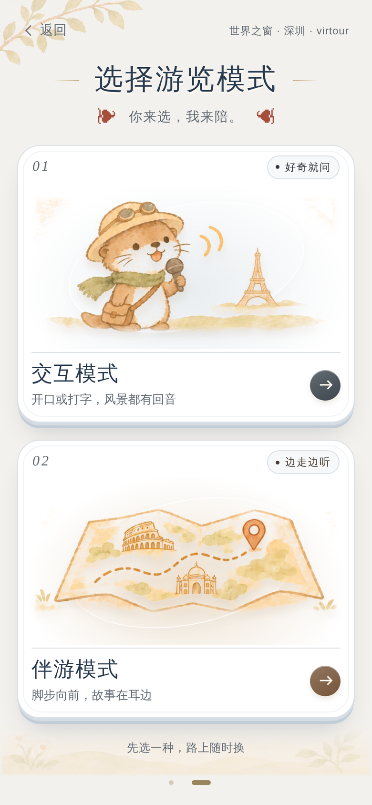

# VirTour 🌍

**VirTour** 是面向深圳世界之窗的数字导览与伴游系统，适配手机、平板与桌面浏览器。项目以手绘地图为游览入口，整合景点资料、数字导游、文字与语音问答、路线推荐及实景全景，让游客在同一界面中完成查找地点、了解景观、安排游览顺序和观察建筑细节。

“沐沐”和“绒绒”两位数字导游贯穿游览过程：在 **交互模式** 中，游客可以开口或打字询问建筑故事、交通与游览建议，并结合图片和全景理解景点；在 **伴游模式** 中，则以沿途讲解、位置轨迹和途经亮点为主。从“这座塔来自哪里？”到“下一站去哪儿？”，VirTour 将找路、看景和听故事串联成连贯的游览体验。

## 📸 项目展示

<table>
  <tr>
    <th>模式选择页</th>
    <th>首页</th>
    <th>全景页</th>
  </tr>
  <tr>
    <td></td>
    <td></td>
    <td></td>
  </tr>
</table>

## ✨ 主要功能

- 地图导览：支持手绘地图缩放、拖动、全园查看，以及景点、餐饮、卫生间和其他服务分类。
- 景点检索：按名称、别名或区域查找地点，查看已有图片与介绍。
- 智能问答：通过文字或语音了解景点故事、游览建议及交通服务信息。
- 路线推荐：根据当前位置与游览需求生成路线示意，展示途经景点和游览顺序。
- 实景带看：支持铁塔全景环顾、固定看点讲解与逐句声画联动，手动操作可中断自动带看。
- 数字伴游：提供“沐沐”和“绒绒”两个导游角色，支持沿途讲解、位置轨迹与途经亮点。
- 会话管理：支持新建对话、调整图文分屏比例与一击恢复历史记录。

## 🧭 使用模式

| 模式 | 使用方式 |
| --- | --- |
| 交互模式 | 主动提问，使用文字或语音获取讲解，并联动地图、图片与全景画面。 |
| 伴游模式 | 以沿途讲解为主，结合位置变化展示游览轨迹；不设置文字输入入口。 |

进入欢迎页后选择模式，也可在导览过程中切换。文字介绍默认不自动播放声音；语音交流需主动开启麦克风。

## 🚀 本地运行

需要 Node.js 24+ 和 npm。获取项目后，在项目目录执行：

```bash
npm ci
npm run dev
```

访问 [http://127.0.0.1:5174/](http://127.0.0.1:5174/)。

地图与本地素材可直接浏览。问答、语音和联网检索需要配置相应服务，参见 [环境配置示例](.env.example)；未配置或调用失败时会明确提示，不使用模拟回答代替。

## 使用说明

- 项目状态：当前为非官方演示原型，不代表景区官方服务。
- 内容范围：目前仅铁塔提供实景全景，其他地点展示已有实拍或资料。知识资料截至 2026-11-12，当日票价、演出与开放安排以景区公告为准。
- 定位与路线：默认使用明确标注的模拟定位；设备定位需要授权。路线为游览示意，不是实测导航，不承诺准确距离、耗时或通行状态。
- 语音体验：需要可用的服务配置与网络，手机麦克风通常要求受信任的 HTTPS。网页切后台或锁屏后，语音和定位可能暂停。
- 数据与隐私：历史记录主要保存在当前浏览器；相关位置上下文会发送至后端，服务端诊断可能保存对话与音频。正式部署前需完善访问控制与隐私保护。

## 相关文档

- [产品与技术说明（阶段文档）](docs/PRODUCT_TECHNOLOGY.md)
- [对话与历史功能](docs/CONVERSATIONS.md)
- [素材来源与许可记录](docs/ASSET_SOURCES.md)

更多方案与阶段记录见 [docs](docs/)。素材使用与商业授权需分别确认。
