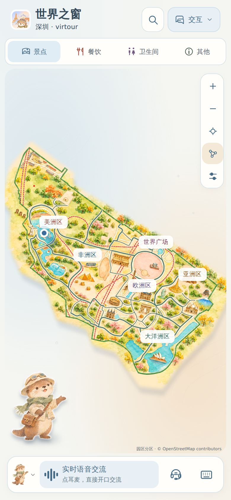
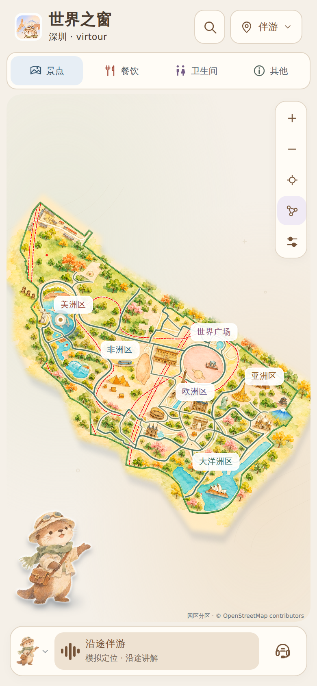

# VirTour 产品与技术文档

深圳世界之窗数字导览与伴游系统｜实现版本 v0.1｜编制日期：2026-11-18

## 一、产品／服务形态与功能展示

**产品定位。** VirTour 面向景区自主游览场景，将手绘地图、景点知识、对话问答、语音讲解与实景全景组织为一体化导览界面，帮助游客完成“找景点—了解看点—安排路线—随讲解观察”的连续体验。当前交付形态为适配手机、平板及桌面浏览器的 Web 集成原型，以深圳世界之窗为示范场景；尚非已商业运营的多景区平台。

*图 1　当前浏览器界面截图，仅展示产品形态；不作为实地试点或实时语音可用性的证明。*

- **交互导览：** 提供景点、餐饮、卫生间、其他四类入口，支持景点搜索、分区筛选、地图缩放与聚焦、图文资料和文字问答。文字会话默认采用约 40% 画面／60% 聊天的分屏，编辑后恢复；历史记录可一击恢复。
- **数字伴游：** 提供“沐沐／绒绒”两个角色；伴游模式不设置文字输入，集成沿途讲解、暂停及途经亮点机制。默认使用明确标注的模拟配置位置；设备定位须授权，到点触发仍待实地验证，不能将模拟移动视为游客真实到访。
- **路线与沉浸讲解：** 根据需求选择景点，生成包含当前位置起始段的手绘路网路线示意。铁塔支持拖动环顾、四个固定看点及逐句语音带看；文字进入全景不自动出声，用户操作可打断自动镜头。

**当前内容规模。** 106 条目录记录，其中 44 处具有已核对的来源坐标；110 条结构化知识覆盖 18 个重点景点等内容，来自已导入文档，资料口径截至 2026-11-12，附录来源未逐条独立核验。目录包含历史条目，不等同官方全量在营清单；仅铁塔具备一组真实六面全景，局部原片缺损待补；其他地点使用已有实拍或资料，不宣称全园全景覆盖。

**能力边界。** 公网文字问答、联网检索资料卡、固定 TTS 全景带看已有验证记录；实时语音链路虽已实现，但当前供应商模型权限拒绝，尚不能按正常可用能力交付。路线不是实测导航，不承诺真实步行距离、耗时、无障碍通行或当日开放情况。

<!-- page -->

## 二、核心技术原理、创新点与技术壁垒

**总体架构。** 前端采用原生 JavaScript ESM、CSS、Canvas 2D 与 WebGL；后端基于 Node.js 24+、Fastify 5、TypeScript 和 WebSocket，统一承载页面、API、工具执行与语音连接。基础大模型、语音及联网搜索调用外部服务，项目不涉及基础模型自主训练。业务链路为“游客输入／页面上下文 → 模型理解与工具选择 → 服务端校验与资料查询 → 回复、资料卡及地图／全景动作”。

### 1. 有来源的知识检索与受约束工具执行

将来源文档离线拆分为结构化条目，保留主题、实体、关键词、章节、日期及来源标识，以实体／别名和主题进行关键词排序，再将命中资料交给模型组织回答；当前未采用 embedding 或向量数据库。后端注册 14 个白名单工具，使用 Zod 严格校验参数；景点、热点及路线坐标由已知数据提供，前端再次验证动作与几何。联网工具经服务端调用 Tavily，只有成功结果才形成来源卡。工具数量不等于全部业务能力可用，例如未核实票价时不生成预算。

### 2. 地理位置与手绘视觉坐标分离

景点、设施及游客位置保留原经纬度，展示时通过三角网格的分片仿射变换映射至手绘图；距离估算和到点判断使用原地理坐标。路线另从底图人工描绘的共享节点构建图，以图像像素长度为边权运行 Dijkstra，前后端共用道路数据指纹并校验每条边。该机制让标记、路线与底图保持一致，但视觉配准和图上最短路径不等于实测地理精度、真实最短路或已核实入口。

### 3. 实际音频时钟驱动的全景带看

铁塔采用六面 Cubemap 渲染，镜头仅接受四个已标注热点。固定讲稿按句合成，携带句首字符位置；浏览器根据已排队 PCM 的实际播放时钟触发字幕高亮与镜头转向，而非按网络返回时刻或字数估算。手动拖动、缩放、新问题和打断会取消讲稿、回调与镜头动画。数字角色采用本地 Canvas 2D 分层动画／图集，嘴部由播放状态驱动，不是完整 3D 数字人或音素级口型同步。

### 4. 跨模态状态一致性与工程可靠性

文字、语音协议和伴游共用工具与页面状态；通过话轮标识、请求取消和迟到事件隔离，避免旧回复覆盖新场景或无关图片串入对话。历史主要存于当前浏览器 localStorage，不提供账户云同步；全景讲稿按实际完整播出的句子归档，中断时保留状态。安全 Markdown 以 DOM 文本节点构建，模型输出不直接作为 HTML 执行；供应商密钥仅留在服务端。

**创新与壁垒判断。** 创新主要体现为应用系统整合：①同一可信地点驱动地图、问答、图片与全景；②手绘图配准和同源路网约束模型动作；③以真实播放进度统一声音、字幕、镜头和归档。潜在壁垒在于景区知识治理、配准标注、道路／热点制作及多模态回归资产，迁移至其他景区仍需重新采集与校准。上述为工程特色，不构成算法首创或排他性技术优势的证明。

**知识产权及成果。** 截至编制日，未取得可核验的项目专利、软件著作权、论文或获奖材料，因此不作相关成果或认证声明。地图、照片、角色与全景素材的权利范围仍须逐项确认；现有来源署名不能替代商业授权。

<!-- page -->

## 三、技术成熟度（TRL）说明

**自评结论：TRL 4——集成原型在受控环境中完成组件联调与验证。** 参考 NASA 九级 TRL 框架 [4]，按软件导览场景类比评估；这是项目自评，不是第三方评级或 NASA 认证，也不表示所有子模块均已达到同一成熟度。

**支持证据。** 最新记录为 528 项自动化测试、类型／语法检查、构建及多尺寸浏览器回归通过；真实公网文字已验证当前位置路线、铁塔全景及联网资料卡，真实固定 TTS 已验证句首镜头同步与手动中断。隔离模型与静音音频夹具用于验证协议、时序和异常路径，不能替代游客使用、实体手机声学或持续运行测试。

**尚不足以进入实景验证阶段的条件。** 当前实时模型初始化被 `AccessDenied.Unpurchased` 拒绝，需恢复权限后重测。iOS 仅有原生壳、后台音频及定位桥接基础，未完成 Mac/Xcode 构建签名与真机验收；Android 无原生客户端，网页不保证锁屏持续定位或收音。尚缺景区现场试点、弱网／噪声／续航数据、响应延迟分位值、问答准确率和游客效果指标。

**升级路径。** 面向 TRL 5—6，应先核实景点、设施及运营资料，完成实时语音和实体设备验收，再开展授权现场试点，记录到点误触发、问答正确率、任务完成率、P50／P95 延迟及故障恢复。对外规模化部署前，还须补齐用户鉴权、访问限流、隐私告知、日志脱敏与保留策略；目前按可信单用户演示环境使用，诊断日志可能含对话等私人内容。

## 四、与国内外同类技术的对比

以下依据厂商官方公开页面作功能与定位比较，并非同条件性能测试；页面未提及某项能力不代表其不具备该能力，不据此宣称全面领先。

| 对象 | 官方公开能力／当前实现 | 与 VirTour 的关系及启示 |
| --- | --- | --- |
| 驴迹智慧导览（国内）[1] | 手绘地图、图文语音、导航、主题路线与设施查询；提供 H5、App／小程序及 API 接入。 | 基础景区导览存在重合。VirTour 重点展示问答驱动的地图与全景联动；覆盖规模、运营能力和导航可靠性尚不宜与成熟产品等量比较。 |
| VoiceMap（国外）[2] | GPS 到点自动播放、路线指引及暂停续播；预下载后音频、地图、照片和文字可离线使用。 | 可借鉴其位置触发与离线体验。VirTour 暂不具备同等经验证的离线及原生可靠性，当前侧重可追问的场景交互。 |
| Smartify（国外，SAAM 案例）[3] | 基于时间、偏好与可达性需求的 AI 个性化导览，配合人工策展内容、多语言／无障碍表达及 AR 游戏。 | AI 个性化并非本项目独有。VirTour 的示范特色是中文景区手绘图、双角色与句级全景带看闭环；仍需内容与游客效果验证。 |
| VirTour（本项目） | 单景区 Web 原型；有来源知识、受约束工具、手绘路线示意及铁塔全景联动。 | 优先验证“边问边看”的连续体验；实时权限、原生能力、商业授权和现场运营尚待补齐，不宣称成本或性能领先。 |

**参考与证据（网页访问日期：2026-11-18）**

[1] 驴迹，智慧导览：https://www.lvji.cn/product/guideTour

[2] VoiceMap，Walking Tour App：https://voicemap.me/walking-tour-app

[3] Smartify，SAAM 案例：https://smartify.org/partners/case-studies/ar-game-smithsonian-american-art-museum

[4] NASA，Technology Readiness Levels：https://www.nasa.gov/directorates/somd/space-communications-navigation-program/technology-readiness-levels/

项目依据：`src/data/`、`server/ai/`、`src/guide/`；验证与边界见 `docs/MAP_POLISH.md`、`docs/CONVERSATIONS.md`、`docs/NATIVE_BACKGROUND.md` 及 `agent-tmp/v12-live/result.json`。本文件描述截至编制日的实际实现，不将规划与测试夹具列为已交付能力。
